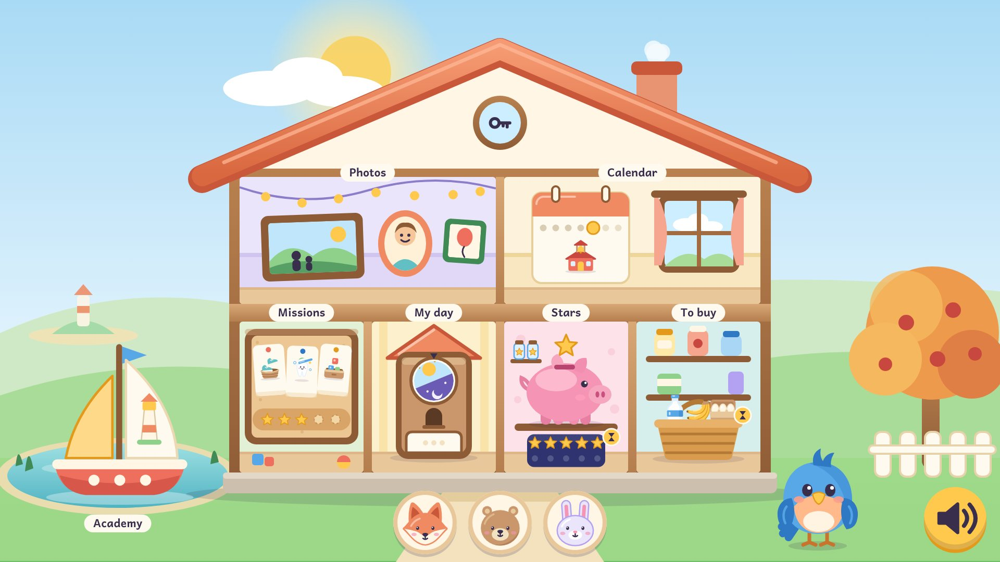
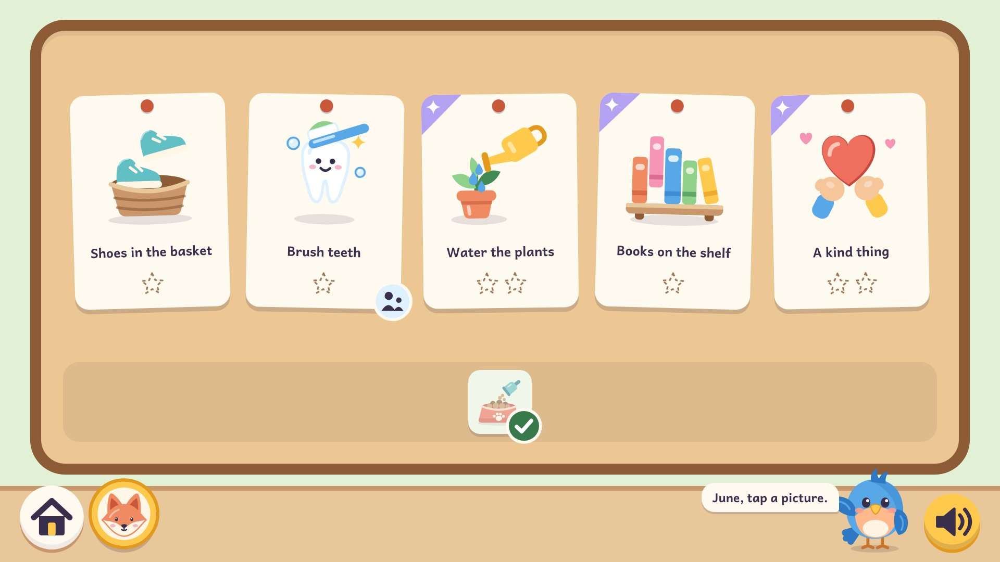
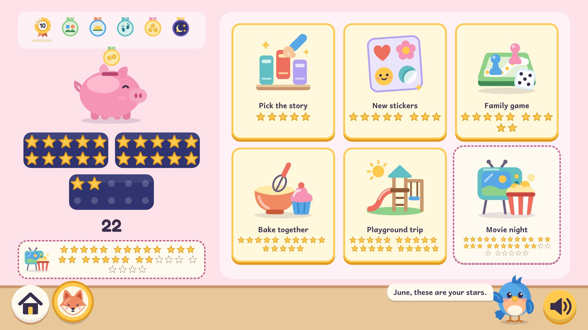
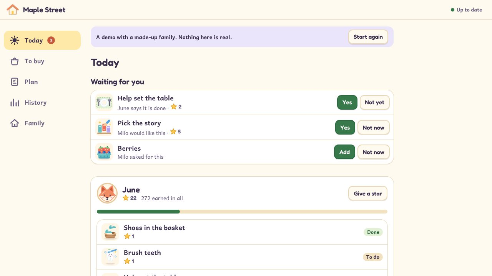

# HOMEBASE

A private family command centre for a 27-inch 4K wall display and the parents' phones. Designed for
pre-readers first: a living illustrated home, not a spreadsheet.



**The wall** shows a house under the real sky. Every room is a picture that is also its news — the missions
board, the day clock, the piggy bank, the pantry, the photo wall, the calendar. A child who cannot read taps
their animal, then a room; a bluebird called Tock says what to do and says it again when asked. Nothing on it
needs reading, typing or dragging, and nothing on it punishes.

**A parent's phone** is where words are allowed: say yes to a finished mission, keep the shopping list, plan the
week, look back, and set everything up.

| Missions | Stars | The grown-ups' side |
| --- | --- | --- |
|  |  |  |

More pictures: [`docs/review/screens/`](docs/review/screens). A short film of a child's journey:
[`docs/review/recordings/wall-journey.webm`](docs/review/recordings/wall-journey.webm).

> **Privacy:** this repository is public. Only synthetic fixtures, code and documentation belong here. Never
> commit family names/photos, calendar credentials, private events, child records, production exports, API keys
> or real device tokens. Store real family data behind authentication in private storage.

Everything in the screenshots is the made-up Maple Street family.

## Try it

```bash
npm install
```

```bash
npm run dev
```

Open the address it prints. With nothing configured this is a **demo** with a made-up family, kept in a folder
called `.data/`. "Open the demo wall" and "Look around the demo as a parent" show both sides. Nothing leaves
your computer, and no account, key or paid service is needed.

## Where it stands

It is built and it works end to end with the made-up family. It has **not** yet met the real display, an
iPhone, a real deployment or a real child — and the documents say so wherever it matters.

| | |
| --- | --- |
| Works here, with automated proof | The wall and its eight rooms; missions, stars and rewards, routines, the shopping list; the grown-ups' side; looking back, export and deletion; pairing a wall; offline use; the real-sky daylight and weather; photos; the Siri key; bringing in Training Academy progress; the optional planning helper (against faked providers) |
| Waiting for the display | Kiosk behaviour, voices, reach, glare, real smoothness, the display's own Calendar Mode and screen saver — [`docs/DEVICE-CHECKLIST.md`](docs/DEVICE-CHECKLIST.md) |
| Waiting for accounts and a say-so | Putting it on the internet (Vercel and a database; about half an hour, nothing paid) — [`docs/DEPLOYMENT.md`](docs/DEPLOYMENT.md) |
| Optional, not built | A calendar glance inside HOMEBASE, four more planning-helper jobs, some enhancements — [`docs/ROADMAP.md`](docs/ROADMAP.md) |

The full account: [`docs/PROGRESS.md`](docs/PROGRESS.md). Every requirement of the brief and where it stands:
[`docs/TRACEABILITY.md`](docs/TRACEABILITY.md).

## Documents

| For… | Read |
| --- | --- |
| A parent using it | [`docs/PARENT-GUIDE.md`](docs/PARENT-GUIDE.md) |
| The person putting it on the internet | [`docs/DEPLOYMENT.md`](docs/DEPLOYMENT.md), [`docs/COSTS.md`](docs/COSTS.md) |
| The hour with the real display (and ten minutes with a child) | [`docs/DEVICE-CHECKLIST.md`](docs/DEVICE-CHECKLIST.md) |
| What is done, what is proven, what is pending | [`docs/PROGRESS.md`](docs/PROGRESS.md), [`docs/TEST_RESULTS.md`](docs/TEST_RESULTS.md), [`docs/TRACEABILITY.md`](docs/TRACEABILITY.md), [`docs/ROADMAP.md`](docs/ROADMAP.md) |
| Why it is built the way it is | [`docs/DECISIONS.md`](docs/DECISIONS.md), [`docs/ARCHITECTURE.md`](docs/ARCHITECTURE.md) |
| How it looks and why | [`docs/ART_DIRECTION.md`](docs/ART_DIRECTION.md), [`design/explorations/`](design/explorations/README.md) |
| What it talks to, and what it sends | [`docs/INTEGRATIONS.md`](docs/INTEGRATIONS.md), [`docs/integrations/`](docs/integrations) |
| Security and privacy | [`docs/THREAT-MODEL.md`](docs/THREAT-MODEL.md) |
| The API and the data | [`docs/API.md`](docs/API.md) |
| Where every drawing, font and dataset comes from | [`docs/ASSETS.md`](docs/ASSETS.md) |

## How it is made

One web app and one small API. The same code runs on the wall, on a phone, on a developer's laptop and on a
host.

- **Interface:** React and TypeScript, built with Vite. The drawings are vector art written as code; motion is
  CSS. No game engine, no animation runtime.
- **Server:** a small Hono API (`server/`), one function on Vercel or one Node process anywhere.
- **Data:** PostgreSQL, with row-level security keeping each household's rows to itself. For development, tests
  and the demo, the same PostgreSQL built to WebAssembly runs inside the app — no database to install.
- **Keeping in step:** every change is a small operation with an id of its own, done once however often it
  arrives; screens work offline and catch up.
- **No required outside service.** Weather and the planning helper are optional and off by default.

```
src/      the wall (src/wall), the grown-ups' side (src/parent), the drawings (src/art), the sync client (src/sync)
server/   the API: sign-in and pairing, the rules of the household (server/domain), the database
shared/   what both sides agree on: the model, the operations, pictures, time
tests/    unit and integration tests      e2e/   browser tests
docs/     everything above                design/  the three directions that were compared
```

## Checks

```bash
npm run verify
```

Formatting, lint, types, 450-odd unit and integration tests, the production build and the browser tests. See
[`docs/TEST_RESULTS.md`](docs/TEST_RESULTS.md) for what they cover and what they cannot.

## The brief

HOMEBASE was built from the fifteen files in [`prompt-series/`](prompt-series/00-START-HERE.md), which define
minimum outcomes rather than a ceiling. Where the result departs from them, [`docs/DECISIONS.md`](docs/DECISIONS.md)
says how and why. The companion [Training Academy](https://github.com/JaredVogler2/Training_Academy) is a separate
project: HOMEBASE opens it and can bring a child's progress in, and changes nothing in it. The display's own
calendar and Google Photos screen saver stay first-class: HOMEBASE assumes no undocumented device API.
