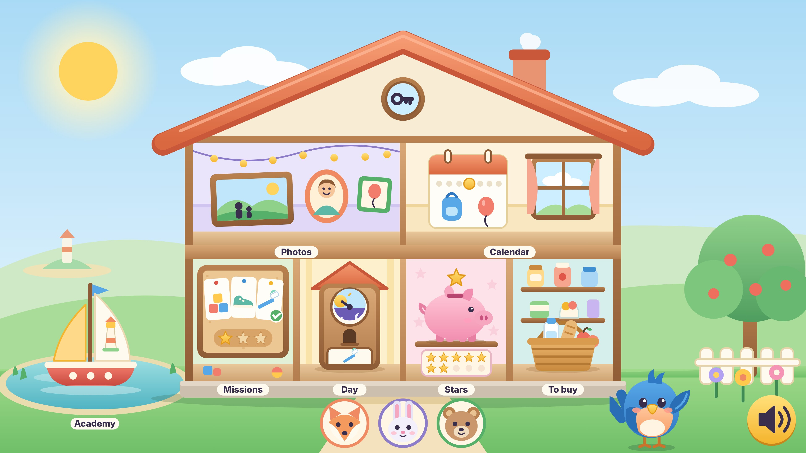
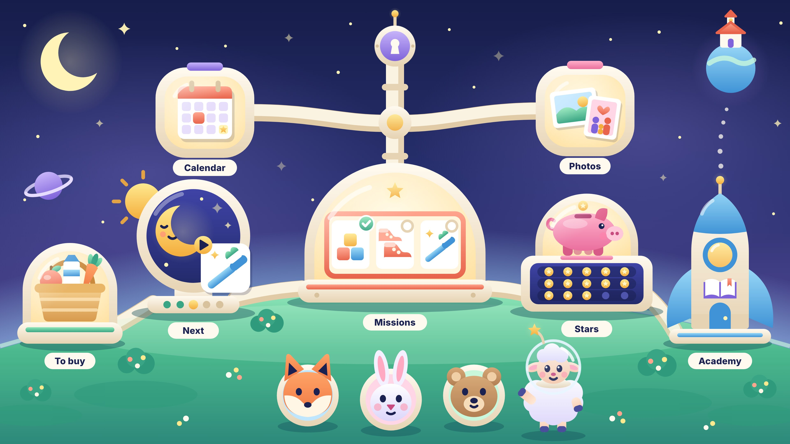
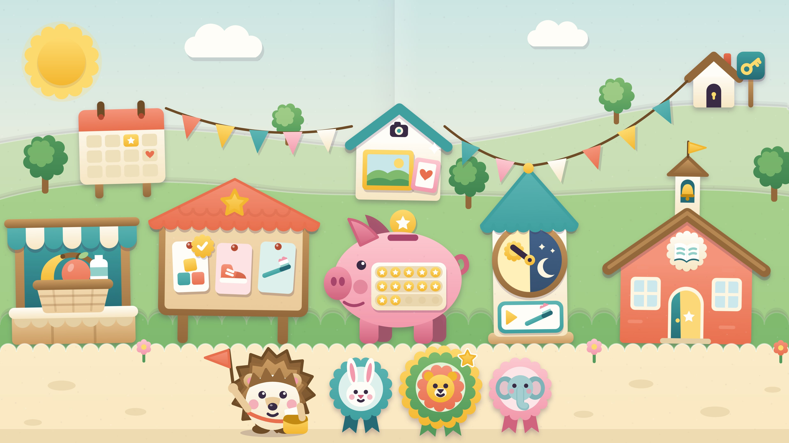
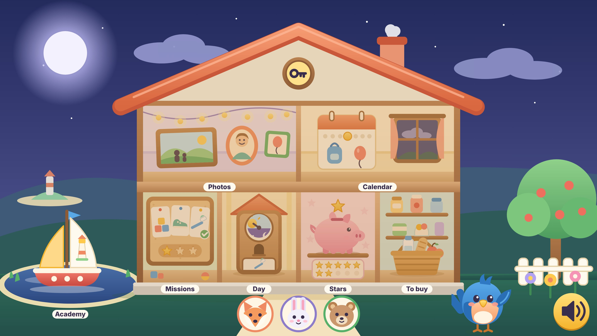
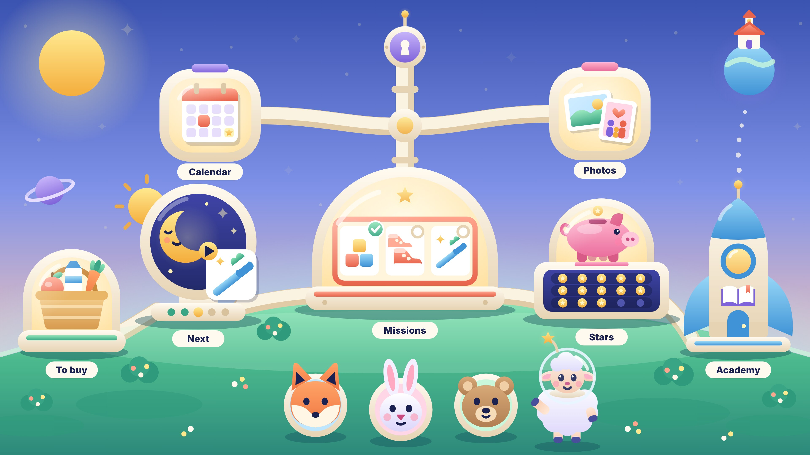
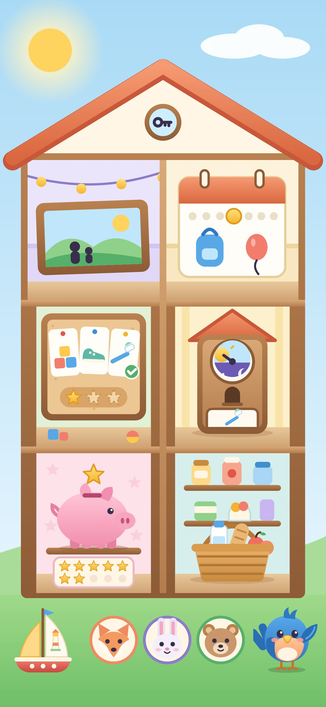
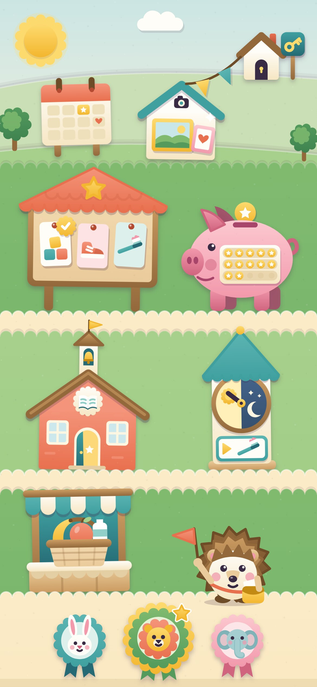

# Three directions for HOME, and the one that was chosen

Before any product code was written, three different worlds were drawn as working prototypes — one HTML file
each, real vector art, rendered in a browser at the wall's size and at a phone's. Each got several rounds of
drawing, looking and correcting, and each was given a fair chance. The files are kept here; open any
`index.html` in a browser.

| | A — Storybook House | B — Starbase Home | C — Paper Village |
| --- | --- | --- | --- |
| Wall, 3840×2160 |  |  |  |
| Another light |  |  | — (no night art was drawn) |
| Phone, upright |  |  |  |
| The world | A cutaway house under a living sky; each room is a module | A snug station on a garden planet; each pod is a module | A pop-up street in cut paper; each building is a module |
| The guide | Tock, the bluebird who lives in the day clock | Nim, a star-lamb in a bubble helmet | Bramble, a hedgehog postie |
| Notes | [`a-storybook-house/NOTES.md`](a-storybook-house/NOTES.md) | [`b-starbase/NOTES.md`](b-starbase/NOTES.md) | [`c-paper-village/NOTES.md`](c-paper-village/NOTES.md) |

## How they were judged

Each direction was scored from 1 to 5 on ten things, weighted by how much each matters to a family with children
who cannot read, a glossy screen on a wall, and bedtime. The scores for B and C are the ones their own authors
gave them where the rubrics overlap; nobody marked their own work up.

| What matters | Weight | A House | B Starbase | C Village |
| --- | :-: | :-: | :-: | :-: |
| A child who cannot read knows what each thing is | 3 | 4 | 4 | **5** |
| The place explains the activity (why is the toothbrush *here*?) | 3 | **5** | 2 | 3 |
| Child modules are low enough to reach | 2 | 4 | 4 | 4 |
| The sky can follow the real daylight and weather at home | 2 | **5** | 1 | 4 |
| Calm at bedtime | 2 | 4 | **5** | 2 |
| Readable in a bright room on a glossy panel | 2 | **4** | 3 | 3 |
| Not the Academy's world over again | 1 | 4 | **5** | 3 |
| Room to grow (new rooms, seasons, a family garden) | 1 | **4** | 3 | 2 |
| Cheap to draw at 4K on a modest chip | 1 | 4 | 4 | 4 |
| Re-flows to a tall phone | 1 | **5** | 4 | 4 |
| **Weighted total (out of 90)** | | **78** | 60 | 63 |

## The decision: A, the Storybook House

1. **A house needs no explaining.** Shoes go by the door, the toothbrush lives in the bathroom, food is in the
   kitchen. A space station and a village both have to teach a child where things are; a home already has.
   C's own author put it plainly: "a toothbrush in a clock tower is a stretch".
2. **The owner asked for the sky to match the real day and the real weather at home.** A house stands under a
   sky; its windows glow when it is dark outside; rain falls on its roof. Space has no weather, and B is night by
   nature. This requirement arrived while the three were being drawn, and it settles what the scores already
   leaned towards.
3. **It is warm at night without going dark.** The night version keeps the rooms lit like a house you are glad to
   come back to, while the rest of the screen dims — calm for bedtime, and still readable.
4. **Height means something.** Children's rooms are on the ground floor, family rooms upstairs, and the
   grown-ups' door is the attic window, which a small child cannot reach. The layout is the access rule.
5. **It grows.** The garden beside the house fills in as the family does things together; seasons change the
   tree and the sky; a new module is a new room.

## What was taken from the other two

Losing a comparison does not make an idea wrong. These go into the house:

- **From C:** the hero object in every room is drawn as large and as literal as it will go (C's piggy bank *is*
  the bank); a sun-and-moon dial with a plain pointer; a "play" mark on the card for what comes next; tinted
  cut-paper shadows that make a thing look pressable; the child who is playing shown larger, ringed and starred.
- **From B:** star tokens on a dark tray, where they read at a glance; a row of beads under the routine for
  steps done and to come; a tick or an empty ring on the corner of each mission card; warm light from inside a
  thing as the sign that it is alive.

The reasoning is recorded as ADR-004 in [`docs/DECISIONS.md`](../../docs/DECISIONS.md), and the standard the
chosen direction is drawn to is [`docs/ART_DIRECTION.md`](../../docs/ART_DIRECTION.md).

## What these prototypes are not

They are pictures of one screen. Nothing in them is tappable, nothing is saved, and none of them was seen on the
wall display or by a child. They were made to choose a direction, and that is all they show.
