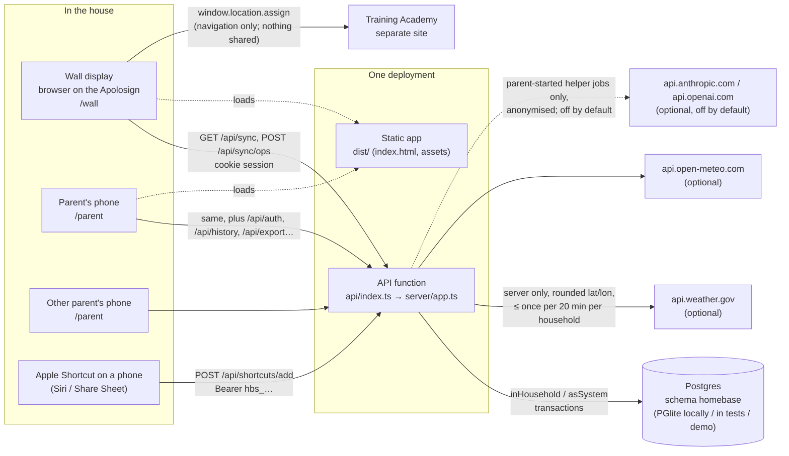
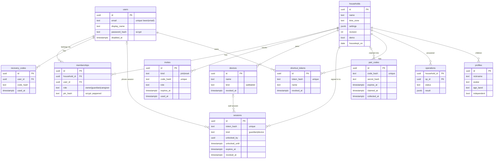
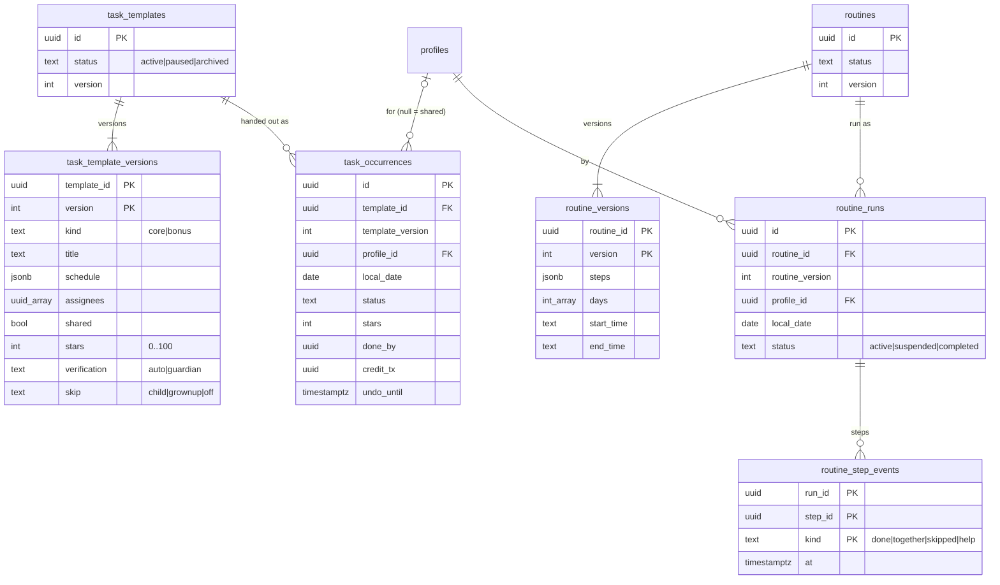
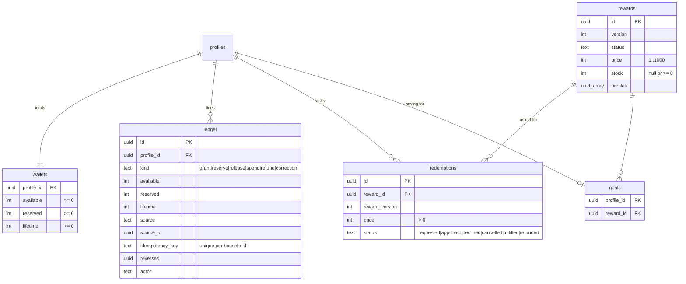
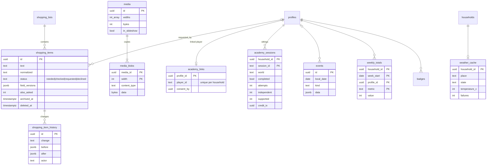

# HOMEBASE architecture

What the code is, as of commit `29de448` (see
[Things that changed while this was written](#things-that-changed-while-this-was-written)). Every statement
here was checked against the source; where something is not built it says so. The reasons behind the choices are
in [`docs/DECISIONS.md`](DECISIONS.md); this page describes, it does not argue.

Companion pages: [`API.md`](API.md) (every route and operation), [`THREAT-MODEL.md`](THREAT-MODEL.md),
[`COSTS.md`](COSTS.md), [`INTEGRATIONS.md`](INTEGRATIONS.md).

## 1. The pieces

One deployable: a Vite-built single-page React app (`src/`, built to `dist/`) and one Hono API (`server/`) that
runs as a single Vercel function (`api/index.ts`), inside Vite's dev server on a laptop (`vite.config.ts`, the
`homebase-api` plugin), or behind a plain Node server (`server/standalone.ts`, `npm start`). Rules shared by
both sides live in `shared/`.



**AI providers (optional).** `server/ai/*` calls `https://api.anthropic.com/v1/messages` or
`https://api.openai.com/v1/responses` over plain HTTPS (no provider SDK), only for a job a parent starts on their
phone, only if the server has that provider's key **and** a parent has switched the helper on and ticked which
data categories may be shared. Drafts come back as proposals that a parent applies through the normal op runner,
limited to `routine.create`, `task.create` and `shopping.edit`. Details: [`integrations/AI.md`](integrations/AI.md),
[`API.md`](API.md), [`THREAT-MODEL.md`](THREAT-MODEL.md) row 25. Tested by
`tests/server/ai.test.ts` (against a mock provider; no live provider call is made by the tests) and
`tests/server/ai-units.test.ts`.

What is **not** in the picture because it does not exist in the code:

- **Calendar feeds.** The `connections` table allows `provider = 'calendar_ics'` and `seal()`/`unseal()` in
  `server/auth/crypto.ts` can encrypt a feed address, but nothing writes a connection or fetches a calendar.
- **Websockets, realtime, push.** Screens poll (section 4).
- **E-mail.** Nothing sends mail (`server/http/routes/auth.ts` header comment; there is no mail dependency in
  `package.json`).

## 2. Folders and module boundaries

Presentation (`src/`) and domain rules (`server/domain/`, `shared/`) are separate. `server/http/routes/*` are thin:
they check who is asking and hand over to `server/domain/*`. Every household change made by a screen goes through
the operations runner (`server/ops/run.ts`) and the handler table (`server/ops/handlers.ts`).

| Module | Files | Owns | Must not |
| --- | --- | --- | --- |
| Identity and pairing | `server/auth/crypto.ts`, `server/auth/sessions.ts`, `server/auth/rate-limit.ts`, `server/http/routes/auth.ts`, `server/http/routes/pair.ts`, `src/parent/auth/*`, `src/wall/Pair.tsx` | users, sessions, recovery codes, invites, reset links, pair codes, wall PIN unlock, rate-limit counters | run as the household role (it uses `asSystem` because it reads tables the household role cannot); store any secret except as a hash |
| Household, roles, profiles | `server/domain/family.ts`, `shared/settings.ts`, `src/parent/pages/{Children,GrownUps,Screens,Settings,Sky}.tsx` | profiles, memberships (role changes, removal), devices (rename, revoke), settings, milestones, calendar day labels, calendar rules | change the owner's role or remove the owner (`setMemberRole`, `removeMember` refuse) |
| Missions | `server/domain/quest.ts`, `shared/schedule.ts`, `shared/safety.ts`, `src/wall/scenes/Quest.tsx`, `src/parent/pages/{MissionEditor,Plan,Today}.tsx` | task templates and their versions, occurrences, approval road | post stars except through `post()` in `server/domain/ledger.ts`; create occurrences for a past day |
| Routines | `server/domain/routines.ts`, `src/wall/scenes/Routines.tsx`, `src/parent/pages/RoutineEditor.tsx` | routines and versions, runs, step events | give a step's mission stars except by calling `submitOccurrence` (one mission, one credit) |
| Stars ledger and rewards | `server/domain/ledger.ts`, `server/domain/bank.ts`, `src/wall/scenes/Bank.tsx`, `src/parent/pages/RewardEditor.tsx` | ledger, wallets, rewards, redemptions, goals | update or delete a ledger line (the database refuses, section 5) |
| Shopping | `server/domain/shopping.ts`, `shared/shopping.ts`, `server/http/routes/shopping.ts`, `server/http/routes/shortcuts.ts`, `src/wall/scenes/Pantry.tsx`, `src/parent/pages/Lists.tsx` | lists, items, item history, suggestions, Shortcut keys | follow a pasted link (links are stored, never fetched by the server) |
| Calendar labels | `server/domain/family.ts` (`setCalendarDay`, `saveCalendarRule`, `listCalendar`), `src/wall/scenes/Calendar.tsx`, `src/parent/pages/CalendarDays.tsx` | `calendar_days` (a picture per day), `calendar_rules` | keep event titles, places or people (only a picture id is stored). Rules are saved but nothing applies them yet, because no calendar is read |
| Photos | `server/http/routes/media.ts`, `server/domain/family.ts` (`updateMedia`, `removeMedia`, `listMedia`), `src/lib/photos.ts`, `src/wall/scenes/Memories.tsx`, `src/parent/pages/Photos.tsx` | `media`, `media_blobs` (bytes in Postgres) | accept anything but JPEG/WebP by magic bytes; show a non-slideshow photo to a locked wall |
| Academy adapter | `shared/academy.ts`, `server/domain/academy.ts`, `server/http/routes/academy.ts`, `src/wall/scenes/Academy.tsx`, `src/parent/pages/AcademyPage.tsx` | `academy_links`, `academy_sessions`, the import, the summary | trust any star count in the file; store the file, answers or timings ([`integrations/ACADEMY.md`](integrations/ACADEMY.md)) |
| History and export | `server/domain/history.ts`, `server/domain/export.ts`, `server/domain/housekeeping.ts`, `server/http/routes/history.ts`, `src/parent/pages/{History,Records}.tsx` | events, weekly totals, audit reading, export, deletion, daily thinning | answer a wall (every route uses `requireGuardianSession`) |
| Weather | `server/weather/*`, `shared/sun.ts`, `src/wall/sky.ts` | `weather_cache`, the two providers, the sun and moon maths | be called from a browser; send anything but a rounded position ([`integrations/WEATHER.md`](integrations/WEATHER.md)) |
| Sync engine | `shared/ops.ts`, `server/ops/run.ts`, `server/ops/handlers.ts`, `server/domain/snapshot.ts`, `server/domain/context.ts`, `server/http/routes/sync.ts`, `src/sync/*` | operations, revisions, snapshots, the client outbox and cache | let a screen choose its own access level |
| AI helper | `server/ai/*`, `server/http/routes/ai.ts`, `shared/ai.ts`, `src/parent/pages/Helper.tsx` | `ai_usage`, `ai_proposals`; calls to the two model providers | apply anything itself (drafts only); produce any op outside `AI_ALLOWED_OPS` (`routine.create`, `task.create`, `shopping.edit`); run from a wall |
| Badges | `server/domain/badges.ts`, `shared/badges.ts`, `src/art/badges.tsx` | `badges`: awarded by `awardBadges` after any op in `BADGE_OPS` (`server/ops/run.ts`), in the same transaction; sent in every snapshot | take a badge away (a correction can take stars back, never a badge) |
| Shared visual pieces | `src/art/**`, `src/styles/*`, `src/parent/ui/*`, `src/wall/chrome/*`, `shared/pictures.ts` | drawings, palette, tokens, parent UI kit | — |

### Import rules that are enforced

`eslint.config.js` (`no-restricted-imports`) enforces three rules; `npm run lint` fails on a breach:

- `src/**` must not import `server/**` ("Put shared rules in shared/").
- `server/**`, `shared/**` and `api/**` must not import `src/**` or use the `@/` alias.
- `shared/**` must not import `server/**`, `node:*`, `pg`, `hono` or `drizzle-orm` (it runs in the browser too).

Enforced by a test rather than lint: `tests/shared/boundaries.test.ts` fails if `asSystem` is used outside an
allow-list (`server/db/client.ts`, `server/app.ts`, `server/domain/seed.ts`, and the routes `auth`, `pair`,
`shortcuts`, `demo`, `cron`, `sync`, `history`, `media`, `ai` — each with its reason in the test), if
`server/domain/*` (other than `seed.ts`) imports HTTP code or uses `asSystem`/`inHousehold`, or if `src/` imports
server code (`uses system-level database access only in the files that have a reason to`, `keeps the rules of the
household free of the web and of the database connection`, `keeps what the browser runs free of anything from the
server`).

## 3. The life of a tap

A child taps "I did it" on a mission on the wall. File by file:

```mermaid
sequenceDiagram
  autonumber
  participant W as Wall (src/sync/store.ts)
  participant IDB as IndexedDB (src/sync/cache.ts)
  participant API as POST /api/sync/ops (server/http/routes/sync.ts)
  participant RUN as applyOps (server/ops/run.ts)
  participant DB as Postgres
  participant P as Parent's phone
  W->>W: dispatch('occurrence.submit') — new UUID op id; optimistic view shows "sent"
  W->>IDB: addToOutbox(op)
  W->>API: { ops: [op] } with cookie
  API->>API: middleware: Origin check, session from cookie (server/app.ts)
  API->>RUN: applyOps(requester, ops)
  RUN->>DB: BEGIN; set_config('app.household_id'); SET LOCAL ROLE homebase_app
  RUN->>DB: SELECT households … FOR UPDATE (lockHousehold)
  RUN->>DB: SELECT operations WHERE op_id = … (seen before? → same answer)
  RUN->>RUN: access check from session (accessOf) and input validation (valibot)
  RUN->>DB: SAVEPOINT; handler → quest.submitOccurrence → ledger.post (if auto-verified)
  RUN->>DB: UPDATE households SET revision = revision + 1
  RUN->>DB: INSERT operations (op_id, status, result); COMMIT
  API->>DB: snapshotFor() in a new transaction
  API-->>W: { outcomes, snapshot }
  W->>IDB: removeFromOutbox; saveSnapshot
  P->>API: GET /api/sync?since=<old rev>… (next poll, every 4 s while open)
  API-->>P: 200 full snapshot (revision moved) — the phone sees the change
```

Step by step:

1. **Dispatch.** `SyncStore.dispatch` (`src/sync/store.ts`) makes an envelope `{ id: newId(), type, at, input }`,
   appends it to the in-memory outbox, writes it to IndexedDB (`addToOutbox` in `src/sync/cache.ts`), redraws, and
   calls `sync()`. The id is a client-made UUID (`shared/ids.ts`).
2. **Optimistic view.** The view drawn is `applyAll(snapshot, outbox)` (`src/sync/optimistic.ts`). For
   `occurrence.submit` the guess is status `submitted`, never `approved`, and wallets are not moved, so a child is
   never shown stars the server has not given. (On a grown-up's screen `occurrence.approve` and
   `occurrence.markDone` *are* shown as approved straight away; see the caveat in section 7.)
3. **Send.** `push()` sends up to 25 ops (`MAX_OPS_PER_REQUEST` in `shared/ops.ts`) to `POST /api/sync/ops`.
   Requests that fail to arrive are retried with backoff 2, 4, 8, 16, 30 s, ±20 % jitter (`BACKOFF_MS`).
4. **Middleware.** `server/app.ts` sets `Cache-Control: no-store` and other headers, refuses a state-changing
   request that carries the session cookie but a foreign `Origin` (`sameOrigin`), opens the database and resolves
   the session (`findSession` in `server/auth/sessions.ts`), which returns nothing for an unknown, expired or
   revoked token, a removed member or an unpaired device.
5. **One transaction per op.** `applyOne` (`server/ops/run.ts`) runs each op in its own `inHousehold` transaction
   (`server/db/client.ts`): it sets `app.household_id` for the transaction and, where the database supports it,
   `SET LOCAL ROLE homebase_app`, so row-level security confines every query to that household.
6. **Lock.** `lockHousehold` (`server/domain/context.ts`) takes `SELECT … FOR UPDATE` on the household row. Two
   ops for one family never interleave; the second waits and then sees what the first did.
7. **Idempotency.** The op id is looked up in `operations` (primary key `(household_id, op_id)`). If present, the
   stored answer is returned and nothing else happens. This is checked *before* access, so a replay returns what was
   decided the first time.
8. **Access.** `accessOf(session, holdGate)` decides the level from the session alone: a phone session has its
   member role; a wall has the role of whoever unlocked it with a PIN (until `unlocked_until`), otherwise
   `household` (when `settings.wall.holdGate` is on, the default) or `child`. `hasAccess` compares it with the op's
   least level in `OPS`. Then the input is validated with the op's valibot schema. A refusal is stored as the answer.
9. **Handler.** Inside a savepoint (`tx.transaction`), `HANDLERS['occurrence.submit']` calls
   `quest.submitOccurrence`. It checks the child may do this mission (`assertDoer`), refuses a mission more than one
   day old, and, if the mission is `verification: 'auto'` and the daily auto-credit cap allows, approves it and
   calls `credit()` → `post()` in `server/domain/ledger.ts` with key `task:<occurrenceId>:credit:<n>`. Otherwise it
   marks it `submitted` for a grown-up. A `Reject` rolls back the savepoint and is stored as a `rejected` answer.
10. **Ledger.** `post()` checks the child is in the household, locks (or creates) the wallet row `FOR UPDATE`,
    looks for an existing line with the same idempotency key (unique index `(household_id, idempotency_key)`),
    refuses a negative balance (`not_enough_stars`), inserts the line and updates the three totals in the same
    transaction. Database checks back this up (section 5).
11. **Badges and revision.** If anything changed and the op is one of `BADGE_OPS` (`occurrence.submit` is),
    `awardBadges` (`server/domain/badges.ts`) writes any badge newly reached, in the same transaction
    (`tests/server/badges.test.ts`, `gives the first star its badge, once, to the child who earned it`). Then
    `bumpRevision` adds one to `households.revision`. The answer is written to
    `operations` and the transaction commits. Any other error (not a `Reject`) rolls everything back and the op is
    answered `retry`, so the client keeps it and sends the same id again later.
12. **Snapshot back.** The route then builds a fresh snapshot for this session (`snapshotFor` → `buildSnapshot`,
    `server/domain/snapshot.ts`) and returns `{ outcomes, snapshot }`. The client removes answered ops from the
    outbox and IndexedDB, saves the snapshot, and shows any rejection as a notice.
13. **The parent's phone.** It polls `GET /api/sync?since=<rev>&access=<level>&today=<date>`. If the revision,
    the viewer's access level and the local date are all unchanged, the server answers 204 with no body; otherwise
    it sends the whole snapshot. The phone replaces what it had. There is no merge on the client.

The behaviour above is covered by `tests/server/quest.test.ts` (`gives the stars once, however many times "I did
it" is tapped or sent`), `tests/server/isolation.test.ts` (`answers each one in a batch separately, and one bad one
does not undo the good ones`, `is decided by the session, never by which child is "selected"…`,
`does not let a request that was refused while locked go through later when a grown-up unlocks`) and
`tests/server/shopping.test.ts` (`adds a queued item once when a phone that was offline sends its queue twice`).

**Client store tests.** `tests/server/store.test.ts` drives the real `SyncStore` (`src/sync/store.ts`, with the
in-memory cache from `src/sync/cache.ts`) against a test server (`shows a tap at once, sends it once, and ends up agreeing
with the server`; `keeps what was asked while there is no signal — through a reload — and sends it exactly once`;
`says a refusal gently, forgets the request, and shows things as they really are`; `forgets everything the moment
the server says this screen is a stranger`; `asks "anything new?" with what it has…`). The optimistic reducers
are still not tested one by one. (`tests/client/` has `derive`, `photos`, `pictures` and `zcta` tests.) The Playwright browser tests in `e2e/` (11 spec files, 25
`test(...)` definitions run across four viewport projects: `wall-1080`, `wall-720`, `tablet-tall`, `phone`) drive
the whole app, so they exercise the sync client end to end: pairing, a parent's approval reaching the wall,
rewards, shopping, a non-reader's walk through the wall, the first-visit tour, accessibility (axe), reduced
motion, layouts and an offline reload (`e2e/offline.spec.ts`, which needs the built app and its service worker).
I did not run them; the person who maintains them reported the last full run as passing apart from one renamed
selector since fixed. CI runs them (`.github/workflows/ci.yml`, job `browser`, plus the offline spec against the
production build).

**Concurrency caveat.** The server tests run on PGlite, which serves one connection, so requests that a test fires
"at once" (`Promise.all`) reach the database one after another. The row locks are therefore not truly contended in
the default test run. `npm run test:pg` runs the same server tests on a real PostgreSQL; the CI workflow
(`.github/workflows/ci.yml`) runs it on PostgreSQL 16. The CI database user is a superuser; isolation is still
exercised there because household work steps down to `homebase_app`, which is not. Whether that workflow has
actually run on GitHub could not be checked from here.

## 4. Polling and pace

| Pace (`PACE_MS` in `src/sync/store.ts`) | Interval | When |
| --- | --- | --- |
| `active` | 4 s | someone touched the wall within `settings.wall.idleHomeSeconds` (default 90 s), at any hour; a parent page that is open |
| `idle` | 30 s | the wall has not been touched for that long, in the daytime, with the house showing |
| `asleep` | 15 min | the wall has not been touched for that long **and** it is quiet hours (`settings.quietHours`, default 19:30–06:30, on) or the photos are showing |

- The wall chooses its pace in `src/wall/Wall.tsx`
  (`store.setPace(!idle ? 'active' : quiet || scene === 'memories' ? 'asleep' : 'idle')`).
- Moving to a quicker pace asks at once (`setPace` in `src/sync/store.ts`). So a touch on a sleeping wall is
  answered with fresh news, and a wall a parent has switched off finds that out the moment anyone touches it —
  untouched, within fifteen minutes.
- Fifteen minutes is deliberately longer than the five after which a sleeping-when-idle database (Neon) goes to
  sleep: an untouched wall lets such a database sleep about two thirds of the time. See [`COSTS.md`](COSTS.md).
- A page that is hidden (`document.visibilityState === 'hidden'`) with an empty outbox stops polling until it is
  shown again; `online`, `focus` and `visibilitychange` wake it.
- A wall that is pairing polls `POST /api/pair/collect` every 3 s until the code is claimed or expires
  (`src/wall/Pair.tsx`).

## 5. The data model

All tables are in the Postgres schema `homebase` (`server/db/schema.ts`, `pgSchema('homebase')`). Migrations are
`server/db/migrations/0000_init.sql` (tables) and `0001_security.sql` (role, row-level security, grants, ledger
trigger); they are embedded into `server/db/migrations.generated.ts` and applied by `migrate()` in
`server/db/migrate.ts` inside one transaction under `pg_advisory_xact_lock`, with a checksum per migration so an
edited migration is refused. `migrate()` also creates `homebase.schema_migrations`.

Every household table has `household_id → households.id ON DELETE CASCADE`, so deleting a household removes
everything of it.

### 5.1 People, devices and sessions



`rate_limits` (`key`, `window_start`, `count`; primary key on the first two) has no relationships.

### 5.2 Missions and routines



### 5.3 Stars and rewards



### 5.4 Lists, Academy, calendar, photos, weather, history, AI



Not drawn, to keep the diagram readable (all hang from `households`): `connections`, `calendar_rules`,
`calendar_days`, `audit`, `milestones`, `ai_usage`, `ai_proposals`.

### 5.5 Every table

"App role" is what `homebase_app` (the role household work runs as) is granted in `0001_security.sql`:
**SIUD** = select, insert, update, delete. "—" means no grant at all: only the owner role (sign-in, pairing,
housekeeping sweeps via `asSystem`) can touch it. Row-level security is enabled on every table listed, including
the "—" ones (which therefore expose nothing through a host's HTTP data API, as the migration's header says).

Retention: "kept" means no code deletes rows except a cascade (child or household deleted). The daily chores
(`keepHouse` in `server/domain/housekeeping.ts`) run for a household the first time any of its screens calls
`/api/sync` on a new local day, or from `/api/cron/daily` (a Vercel cron entry in `vercel.json`, daily at
09:17 UTC). `sweepSystem` (`server/http/routes/sync.ts`)
runs right after a household's daily chores ran in a `GET /api/sync`, and from the cron route. `detailDays`
(default 90, 14–730) and `trendMonths` (default 12, 1–60) are household settings (`settings.history`).

| Table | Purpose | Key constraints | Retention / thinning | App role |
| --- | --- | --- | --- | --- |
| `households` | the family, its zone, settings JSON, revision counter | — | deleted only by the owner (`POST /api/family/household/delete`) | S; U on `name, time_zone, settings, revision, housekept_on` only; policy `id = app.household_id` |
| `users` | a grown-up's account (e-mail is a sign-in name only) | unique `lower(email)` | deleted with the last household they belonged to | S on `id, display_name, avatar`, only rows of members of the current household |
| `memberships` | user × household × role, wall PIN hash | unique `(household_id, user_id)`; role check | kept until removed / left | SIUD |
| `recovery_codes` | 8 one-use codes per user | — | replaced when new codes are made | — |
| `invites` | join invitations (48 h) and reset links (24 h) | unique `code_hash`; kind, role checks | deleted 30 days after expiry | SIUD (but routes use `asSystem`) |
| `devices` | paired walls/tablets | kind check | kept (revoked rows stay) | SIUD |
| `sessions` | cookie sessions, hashed token, wall unlock | unique `token_hash`; `sessions_subject_check` (guardian ⇔ user, device ⇔ device) | deleted 30 days after expiry or revocation | — |
| `pair_codes` | a wall waiting to be claimed (10 min) | unique `code_hash` | deleted 1 day after expiry | — |
| `rate_limits` | attempt counters per key per window | PK `(key, window_start)` | windows older than 24 h deleted | — |
| `shortcut_tokens` | Siri/Shortcuts keys (hash only) | unique `token_hash` | kept (revoked rows stay) | SIUD |
| `operations` | answered ops by client id | PK `(household_id, op_id)` | deleted after 30 days | SI |
| `profiles` | child: nickname, avatar, age band | age band check | kept; archived or deleted by a parent | SIUD |
| `task_templates` | a mission's identity and current version | status check | kept | SIUD |
| `task_template_versions` | each edit's words, schedule, stars | PK `(template_id, version)`; kind, verification, skip checks; `stars 0..100`; `effort 1..3` | kept | SI |
| `task_occurrences` | one mission for one child (or shared) on one local day | unique `(template_id, local_date, coalesce(profile_id, nil-uuid))`; status check; `stars 0..100` | settled rows (not `submitted`) older than the whole week before `today − detailDays` counted into `weekly_totals` and deleted | SIUD |
| `wallets` | three running totals per child | checks `available, reserved, lifetime >= 0` | kept | SIU |
| `ledger` | append-only star lines | unique `(household_id, idempotency_key)`; kind and source checks; `ledger_shape_check` (each kind may move only certain totals); trigger `ledger_append_only` refuses UPDATE, and DELETE except from a cascade | kept for ever (until the child or household is deleted) | SI |
| `rewards` | the shop | status check; `price 1..1000`; `stock null or >= 0` | kept (archived stays) | SIUD |
| `redemptions` | a child's request and its state | status check; `price > 0` | kept | SIUD |
| `goals` | the reward a child is saving for | PK `profile_id` | removed when asked for or the reward is paused/archived | SIUD |
| `routines` | a routine's identity and version | status check | kept | SIUD |
| `routine_versions` | each edit's steps, days, window | PK `(routine_id, version)`; skip check | kept | SI |
| `routine_runs` | one child's go at one routine on one day | unique `(routine_id, profile_id, local_date)`; status check | deleted with the same cutoff as occurrences (step events cascade) | SIUD |
| `routine_step_events` | what happened to each step | PK `(run_id, step_id, kind)`; kind check | with their run | SIUD |
| `shopping_lists` | lists | kind check | kept (archived stays) | SIUD |
| `shopping_items` | items | status check; `quantity null or 1..999` | checked or declined items archived after 3 days; archived/removed items deleted `detailDays` after archiving/removal | SIUD |
| `shopping_item_history` | who changed what on an item | — | deleted with its item (cascade) | SI |
| `academy_links` | child ↔ Academy player id, with consent | unique `(household_id, player_id)` | until unlinked | SIUD |
| `academy_sessions` | one row per Academy sitting (totals only) | PK `(household_id, session_id)` | until unlinked | SIUD |
| `connections` | outside-service connection with encrypted secret | provider check (`calendar_ics` only) | **never written by any code** | SIUD |
| `calendar_rules` | word → picture rule | — | kept | SIUD |
| `calendar_days` | picture labels for a day | PK `(household_id, local_date, label, source)` | kept (not thinned) | SIUD |
| `media` | a photo's metadata | — | removed rows deleted at once (blobs cascade); rows with no copies older than 1 day deleted | SIUD |
| `media_blobs` | the photo bytes, per width | PK `(media_id, width)` | with their photo | SIUD |
| `weather_cache` | last reading per household | PK `household_id` | overwritten; not shown after 6 h | SIUD |
| `events` | coarse look-back record (minute precision) | — | older than the whole week before `today − detailDays`: folded into `weekly_totals` (for some kinds) and deleted; a parent can delete one (`history.forget`) | SID |
| `weekly_totals` | per week, child, metric | PK `(household_id, week_start, profile_id, metric)` | older than `trendMonths × 31` days deleted | SIUD |
| `audit` | who changed the set-up | — | deleted after 400 days | SI |
| `milestones` | a family's notes | — | kept | SIUD |
| `badges` | earned keepsakes | PK `(profile_id, badge)` | kept for good (`awardBadges` inserts, nothing deletes except a cascade) | SIUD |
| `ai_usage` | model cost per request, plus `reserved` / `released` book-keeping lines for requests in flight | — | deleted after 400 days | SI |
| `ai_proposals` | AI drafts awaiting a grown-up | status check | kept; not thinned | SIUD |
| `schema_migrations` | applied migrations and checksums (made by `migrate()`, not in `schema.ts`) | PK `tag` | kept | — |

Two retention details worth knowing:

- Archived and removed shopping items are **deleted** `detailDays` after they were archived, and their history
  goes with them by cascade (`thinHistory`; the comment in `server/http/routes/shopping.ts` says so). With the
  default 90 days the 120-day suggestion window is therefore effectively about 90 days plus however long an item
  stayed on the list. `tests/server/suggestions.test.ts` (`… survives the tidy`) covers the archive step, not the
  later deletion.
- `media` has a `deleted_at` column that no code sets (queries still filter on it); `media.remove` deletes the
  row outright.

### 5.6 How isolation is enforced

- `inHousehold` (`server/db/client.ts`) runs `select set_config('app.household_id', $1, true)` and, if the role
  could be used at start-up (`detectRls`), `set local role homebase_app`. Both last only for the transaction, so
  they work through a transaction-mode pooler (PROVIDER-FACTS §3 says settings last for the transaction only on
  Supabase's pooler, and `SET LOCAL` inside a transaction is Neon's documented way).
- If `homebase_app` cannot be used (for example the database user may not create or assume roles),
  `openDatabase` logs a warning and **continues with application-only isolation**: every query still filters by
  `household_id`, but the database no longer enforces it. `GET /api/health` then reports `"isolation":
  "application"` instead of `"database"`. Check this after deploying.
- Tested: `tests/server/isolation.test.ts` (`are kept apart by the database itself, whatever the query asks for`,
  `keeps accounts, sessions and codes out of reach of household work altogether`) — on PGlite. Whether
  `CREATE ROLE`/`GRANT … WITH SET TRUE` succeeds on a hosted Supabase or Neon database has **not** been verified.

## 6. Time

- **A day is a calendar day where the family lives.** `localDateOf(instant, timeZone)` (`shared/time.ts`) uses
  `Intl.DateTimeFormat` with the household's IANA zone. Day arithmetic (`addDays`, `daysBetween`,
  `startOfWeek`) is done on `YYYY-MM-DD` strings through UTC dates, never by adding 24 hours. Instants are
  `timestamptz`; days are `date` columns.
- **Daylight saving.** `isOfferedOn` (`shared/schedule.ts`) answers "is this mission offered on that calendar
  day?" from the calendar alone and never looks at a clock. `instantOf` handles a spring-forward gap (first
  instant after it) and a fall-back repeat (first occurrence). Tested by `tests/server/quest.test.ts` (`hands out
  one day's missions for each calendar day through a spring-forward and a fall-back`, America/Chicago and
  Europe/London) and the sky tests in `tests/shared/colour-sky.test.ts`.
- **One mission per template, child and local day.** Enforced by the unique index `task_occurrences_once_key`
  on `(template_id, local_date, coalesce(profile_id, '00000000-…'))`; `ensureOccurrences`
  (`server/domain/quest.ts`) inserts with `ON CONFLICT DO NOTHING`. Tested by `gives each child their own, once,
  however many screens ask`. Routine runs have the same rule (`routine_runs_once_key`).
- **No backfill.** `ensureOccurrences` returns at once for a date before today. Days are generated only for
  "today" (in `keepHouse` on the first sync of the day, and when a mission or child is created or changed), so a
  day nobody opened the wall has no missions and nothing is recorded as missed. Tested by `does not hand out the
  days nobody opened the wall`.
- **Late taps.** `submitOccurrence` accepts a mission dated today or yesterday and refuses older ones
  (`not_allowed_now`). Snapshots carry today's occurrences plus `submitted` ones from the last two days, so a
  grown-up can still approve yesterday's.
- **Edits do not rewrite history.** Editing a mission writes a new version; only today's and later occurrences
  still `available` are deleted and re-made with the new version (`updateTask`). Tested by `changes today's
  untouched copies and leaves what was already done as it was`.
- **Changing the household's time zone** (`household.rename` takes a zone) has no special handling beyond the next
  day's chores using the new zone. Not tested.
- **The client's clock** is used only for display; `SyncStore.serverNow()` corrects it by the skew from the last
  snapshot's `serverTime`. Every decision (undo windows, unlock expiry, "today") is made with the server's clock.

## 7. Conflict behaviour, by entity

| Entity | What happens when two screens change it | Where | Test |
| --- | --- | --- | --- |
| Any op | Ops for one household are serialised by the household row lock; a repeated op id returns the first answer | `server/ops/run.ts`, `lockHousehold` | `isolation.test.ts`, `shopping.test.ts` (`… sends its queue twice`) |
| Star ledger | Never last-write-wins. Lines are only added; each has an idempotency key unique per household (`task:<id>:credit:<n>`, `redemption:<id>:reserve`, `allowance:<child>:<date>`, `academy:<sitting>`, `bonus:<entryId>`, …); a second line with the same key is not written. The wallet row is locked `FOR UPDATE`; negative totals are refused in code and by check constraints; UPDATE/DELETE are refused by grant and trigger | `server/domain/ledger.ts`, `0001_security.sql` | `bank.test.ts` (`can be worked out again from its lines…`, `gives a bonus once…`, `cannot spend the same stars twice…`) |
| Mission occurrence | A state machine: repeating a transition is a no-op (`submitted`/`approved` stay), an impossible one is refused (`not_allowed_now`); approving twice is one approval. Reversal adds a `correction` line and numbers the next credit (`…:credit:<n+1>`) | `server/domain/quest.ts` | `quest.test.ts` (`approving twice or on two phones is one yes`) |
| Mission template, routine, reward | Base-version check: `task.update`, `routine.update`, `reward.update` carry `baseVersion`; a mismatch is `conflict` ("Someone else changed this … first"). `task.status`, `routine.status` have no version check (last one wins); `reward.status` bumps the reward's version | `quest.ts` `updateTask`, `routines.ts` `updateRoutine`, `bank.ts` `updateReward`, `setRewardStatus` | `quest.test.ts` (`tells the second of two parents editing at once that the first got there`) |
| Redemption | State machine `requested → approved → fulfilled / refunded`, `requested → declined / cancelled`; the row is locked `FOR UPDATE`. The child's request carries the `rewardVersion` and `price` it saw; any difference is `price_changed`. Two different answers at once: the first wins, the second is refused | `server/domain/bank.ts` | `bank.test.ts` (`answers once when two parents answer at the same moment — even differently`, `shows a changed price again instead of charging it`) |
| Shopping item | Per-field patch: `shopping.edit` sends only the fields changed and only those are written, so two phones editing different fields both keep their change. Two phones editing the **same** field: the later one wins. `field_versions` counts edits per field but is **never compared** — it is a record, not a check. Adding the same text twice merges into one line (`also_asked + 1`) by normalised text; if the new add names a quantity that differs, the line takes the new quantity and unit (and bumps their field versions) | `server/domain/shopping.ts` (`editItem`, `addItem`) | `shopping.test.ts` (`keeps both changes when two phones edit different things about one item`, `keeps one line when two people add the same thing…`, `takes the amount just said when something already wanted is added again, and keeps it otherwise`) |
| Routine run | One run per routine, child and day; a run keeps the `routine_version` it started with, so editing the routine does not change a run in progress. A step has one answer (a new answer replaces the old); "help" is separate | `server/domain/routines.ts` | `routines.test.ts` (`carries on with the steps it began with when a parent edits the routine half-way`, `counts a tap once…`) |
| Settings | `household.settings` merges a partial patch over the stored settings (objects key by key, arrays and values replaced) and validates the result; no version check, so the later patch of the same key wins | `server/domain/family.ts` `patchSettings` | `isolation.test.ts` (`will not let settings be bent into something else`) |
| Profiles, lists, devices, milestones, calendar | Plain last-write-wins under the household lock | `server/domain/family.ts`, `shopping.ts` | — |

**Client-side caveat.** The optimistic layer shows a grown-up's `occurrence.approve` and `occurrence.markDone` as
`approved` / `credited: true` before the server answers (`src/sync/optimistic.ts`). It does not move wallets. The
brief's rule "optimistic guesses never claim a server decision" holds for the child-facing `occurrence.submit` but
not for these two grown-up reducers. Not tested.

## 8. Environments

The code itself reads only environment variables (`server/config.ts`); it never branches on "preview" or
"production" (it does not even read `VERCEL_ENV`). What differs between environments is which variables are set.

| | Local development | Demo | Preview (Vercel) | Production (Vercel) |
| --- | --- | --- | --- | --- |
| How | `npm run dev` (Vite + API in one process) or `npm run build && npm start` (`server/standalone.ts`) | `HOMEBASE_DEMO=1`, **or** on Vercel with no `DATABASE_URL` | a Vercel preview deployment | the production deployment |
| Database | PGlite in `.data/pglite` (`HOMEBASE_DATA_DIR` to move it), or `DATABASE_URL` if set | whatever is configured; on Vercel without `DATABASE_URL` it is PGlite **in memory** (`memory://`) | `DATABASE_URL` of the preview environment, or none → demo | `DATABASE_URL` |
| Migrations | always applied at start for PGlite | same | applied at first request unless `HOMEBASE_AUTO_MIGRATE=0` | same |
| Data | whatever you make | the made-up "Maple Street" family, seeded on first start (`seedDemo`) and on `POST /api/demo/enter` | real if its `DATABASE_URL` points at real data | real |
| Sign-up | first family owns it unless `HOMEBASE_OPEN_SIGNUP=1` | same; demo routes enabled | same | same |
| Cookies | `hb`, not `Secure` over http | — | `__Host-hb`, `Secure` (https) | same |

- **A deployment without a database can only ever be the demo.** `readConfig`: `demo: flag(HOMEBASE_DEMO) ||
  (onVercel && !databaseUrl)`, and `localData` is `memory://` on Vercel. So a Vercel deployment that has lost or
  never had its `DATABASE_URL` serves the made-up family from memory, not an empty real one.
- **Demo on Vercel is per instance.** Each warm function instance has its own in-memory PGlite, seeded afresh; a
  session cookie made by one instance is unknown to another, so the server answers `401`. For a real household
  the client treats that as "signed out" (`becomeStranger` in `src/sync/store.ts`). For a demo household only, and
  at most once a minute, `reenterDemo` calls `POST /api/demo/enter` again as the same kind of viewer, drops its
  outbox and starts from the new snapshot (tests in `tests/server/store.test.ts`: `walks back in when the server
  has been replaced by a fresh one`, `does not walk a real household back in: signed out means signed out`). What
  a visitor changed in the demo is still lost when the instance changes. None of this has been observed on a real
  deployment.
- **`HOMEBASE_DEMO=1` next to real data**: demo sign-in (`server/http/routes/demo.ts`) only ever opens the
  household with the fixed demo id, and sign-up ignores demo households when deciding whether the deployment is
  taken. It would still add the made-up family to a real database and open a public door to it. `.env.example`
  says never to do this.
- **Preview isolation** depends entirely on giving previews a different `DATABASE_URL` (or none). Nothing in the
  code stops a preview from using the production database if it is given that URL. Vercel Authentication on
  previews is a host setting (PROVIDER-FACTS §2), not something the code checks.
- `HOMEBASE_OFFLINE=1` stops weather requests (`server/weather/service.ts`); the demo does **not** set it
  automatically.

## Things that changed while this was written

This page was first written against `938253c` and brought up to date at `29de448`. In between: `2ea844e`
(service worker, page security headers, `vercel.json`, the cron route, the standalone server, CI), `081412e`
(badges, first-visit tour, celebrations, the what-to-wear hint, `/studio/device`), `9be922e` (the AI helper),
`d231161` (Playwright suite and fixes) and `29de448` (scrubbed logs, upload rate limit, CSV numbers, boundary
tests — several of them answers to gaps this page had recorded). `npx vitest run` at `29de448`: 29 files, 430 tests,
all passing (run while updating this page). Since then: `tests/server/store.test.ts` (the client store against
the real server), the demo's `reenterDemo`, `scripts/measure-wall.ts` (the `measure` script: a headless-browser
measurement of a production build, explicitly not the real display's figures) and the wall's self-chosen "light"
motion (`src/wall/pace.ts`: it watches its own frame rate and stops the ambient movement on a display that
cannot keep up).
