# Art direction

How HOMEBASE looks, moves and sounds, and why. The rules here are the ones the drawings and the code follow;
where a rule is enforced by a test, the test is named.

Three different worlds were drawn as working prototypes before any product code existed — a storybook house, a
space station and a paper village — and compared on what matters to a family with children who cannot read.
That comparison, its scores, and what was taken from the two that lost are in
[`design/explorations/README.md`](../design/explorations/README.md). This page describes the one that was
chosen.

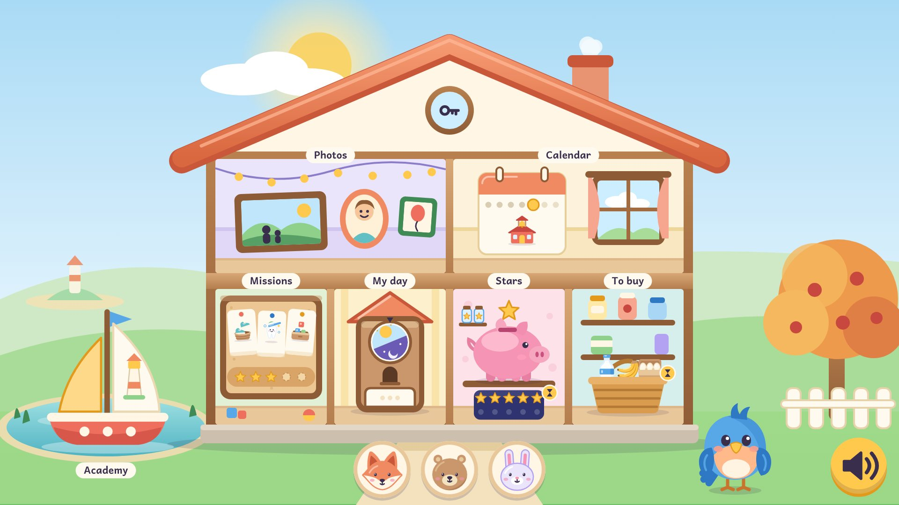

## The idea: a house under a real sky

The wall shows a cutaway house. **Each room is a picture that is also its own news**: the missions board shows
today's cards, the piggy bank shows the stars as stars, the pantry shelf shows what is on the list, the day
clock shows where in the day it is. Nothing is a tile with an icon and a word.

- **A house needs no explaining.** Shoes go by the door, the toothbrush lives upstairs, food is in the pantry. A
  child already knows where things are.
- **Height is the access rule.** What children use is on the ground floor, within reach on a screen mounted on a
  wall. The grown-ups' door is the little window under the roof.
- **The sky is the real one.** The sun and moon are where they are outside the family's own windows, worked out
  on the device from a rough position; with the weather switched on, it rains on the roof when it rains outside
  ([`integrations/WEATHER.md`](integrations/WEATHER.md)). The windows glow when it is dark.
- **It stays a house on a phone.** Upright, the rooms stack three floors high; nothing is dropped
  (`e2e/layouts.spec.ts`: six rooms, the boat, the attic window and the faces, inside the screen and apart, at
  four sizes).

| Evening | Night | Rain | Upright |
| --- | --- | --- | --- |
| 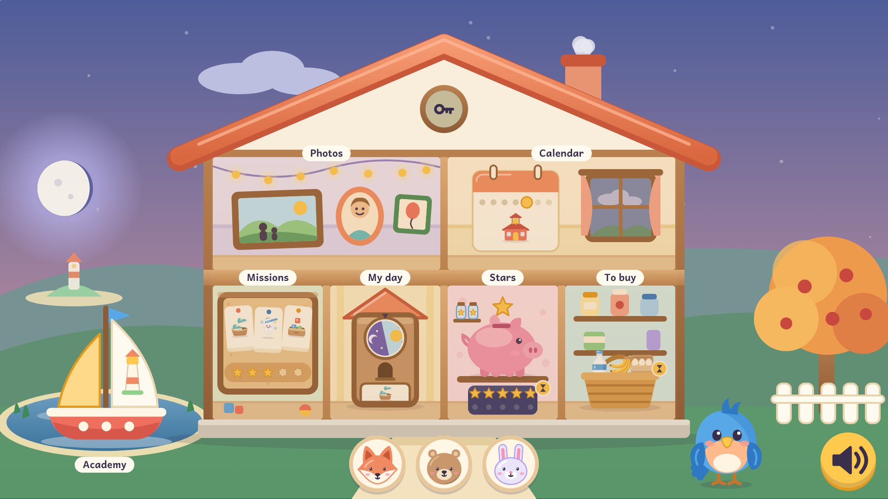 | 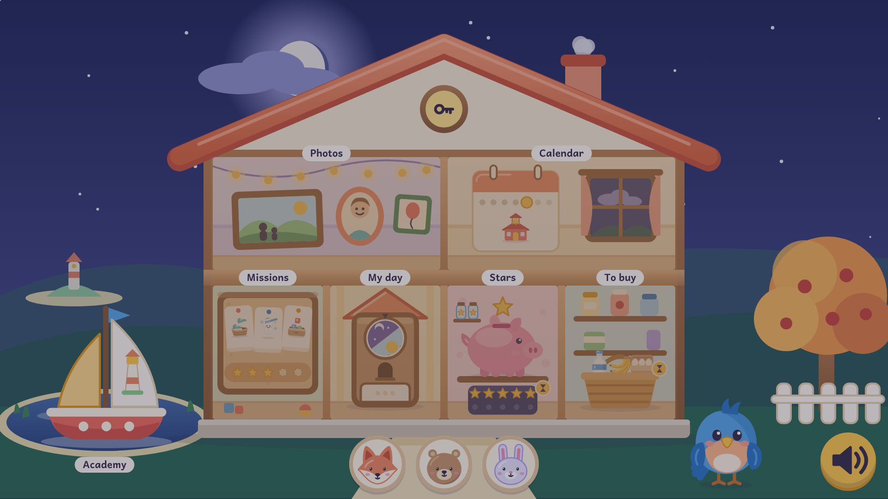 | 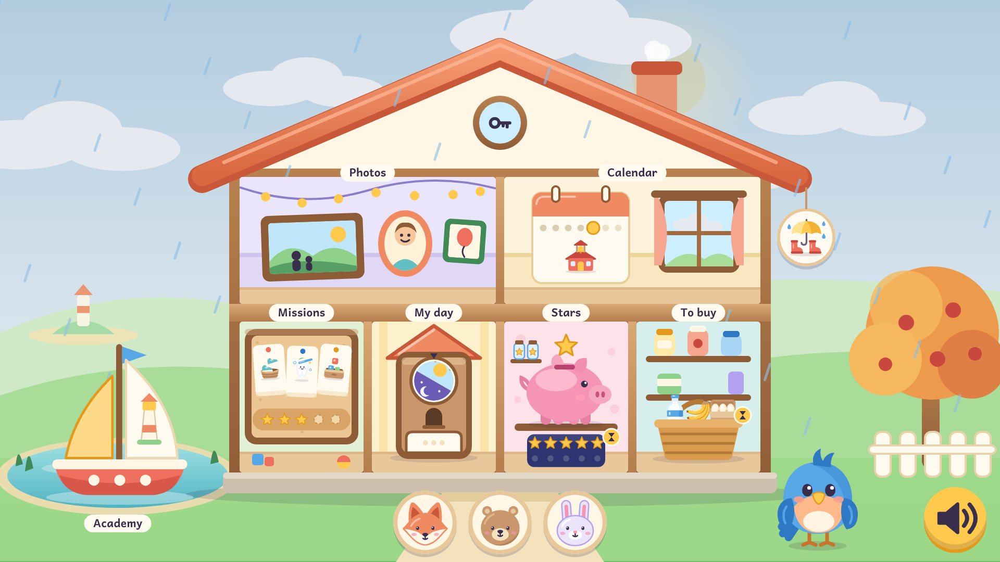 | 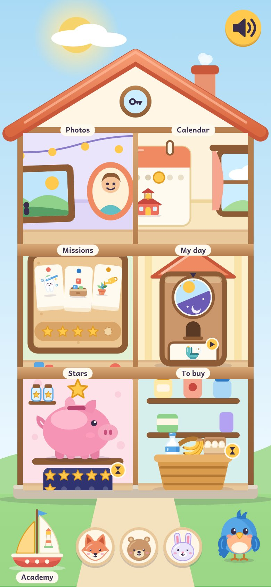 |

## For someone who cannot read

1. **The picture is the label.** Every mission, routine step, reward, shopping item and kind of day has a
   drawing chosen by a parent from a registry (`shared/pictures.ts`): 40 things to do, 18 rewards, 37 things to
   buy, 12 kinds of day, 12 animals to be. Words appear under pictures for a child beginning to read and can be
   switched off; they are never the only way to know what something is.
2. **One guide, one voice.** Tock, a bluebird who lives in the day clock, says what the screen is asking, in
   the device's own voice, and says it again when the loudspeaker is tapped. He points, waves and cheers; he
   never scolds and never counts down.
3. **Quantity is drawn, not written.** Stars are stars, in rows of five on a dark tray; a price is that many
   stars; progress is beads on a string. A number appears only beside its picture.
4. **State has a shape as well as a colour.** Done is a tick in a green disc; waiting for a grown-up is an
   hourglass in a honey disc; "with a grown-up" is two figures; needs another go is a looping arrow. Nothing is
   told by colour alone.
5. **Everything pressable looks pressable and is big.** Controls are at least 64 px at 1080p and sit on a
   tinted "shelf" shadow that shortens when pressed. There is no dragging, no double tap, no long press for a
   child (a grown-up's "hold" buttons exist precisely because a toddler will not find them).
6. **The same thing is always in the same place.** Home is the same button in the same corner of every room;
   Tock and the loudspeaker are in the other.
7. **The first visit is shown, not written.** Tock points at each thing in turn with a ring and a hand; any tap
   ends it and does what was tapped (`e2e/tour.spec.ts`).

The whole journey — choose who you are, find a mission, see your stars, sail to the Academy, come home, ask for
a reward — is walked by a test using pictures and the controls' names alone
(`e2e/non-reader.spec.ts`).

## Colour

One palette for the wall, the phone and every drawing (`src/styles/tokens.css`; the same values for SVG in
`src/art/palette.ts`). Each colour has one job.

| Role | Colours | Used for |
| --- | --- | --- |
| Ink | `#3a2e4d` and two softer steps | Every word, every eye. A warm dark plum, never black, never a large area |
| Paper | `#fffaf0`, `#fff6e6`, `#f3e2c2` | Every surface that carries words. Warm, so a bright room's glare is less harsh |
| Honey | `#ffe9a8` `#ffc94d` `#e39a1c` | The one "this way" colour: stars, the thing to do next, lamplight |
| Terracotta | `#ffd9c7` `#f08a62` `#c9573a` | The roof, warmth, the grown-ups' accents |
| Sage | `#e2f1d6` `#8fd08a` `#37794b` | Growing things, and "done" |
| Teal | `#d6efec` `#62bfc4` `#2b7f8f` | Water, calm, the pantry |
| Bluebird | `#dff0ff` `#58a8e8` `#2569b0` | Tock, links, keyboard focus |
| Rose | `#fde2ea` `#f594b4` `#c9517e` | The piggy bank |
| Lavender | `#ebe5fb` `#b3a2f2` `#6b5bb5` | Night, bedtime, the photo wall |
| Wood | `#e8c79b` `#c9976b` `#8d5b36` | The house's frame, shelves, furniture |

- **Stars only ever mean stars.** Decoration uses four-pointed sparkles, so a child never miscounts.
- **Shadows are tinted ink, never grey**, and never blurred into a glow: flat shapes, a darker edge beneath.
- **Text contrast is at least 4.5:1** on the grown-ups' side and for every word on the wall. The deep sage and
  deep bluebird were darkened to 5.2:1 on paper after the accessibility scan found them at 4.2–4.4
  (`e2e/a11y.spec.ts`, axe, no exclusions). A stronger-contrast setting darkens outlines and words further.
- **The sky is a ramp, not a picture.** Five colour stops from night through dawn, day and dusk are mixed by
  the sun's real height, and greyed under cloud (`src/wall/sky.ts`; `tests/shared/colour-sky.test.ts`).
- **Charts on the grown-ups' side** use a separately checked set of colours that stay apart for people with
  colour-vision differences, with direct labels, a table view, and keyboard focus (`src/parent/ui/charts.tsx`).

## Type

- **Fredoka** (rounded, friendly) for headings and the wall's few words. **Andika** for anything read at
  length: it was designed for people learning to read — a one-storey *a* and *g*, an *l* that cannot be taken
  for an *I*, generous spacing.
- On the wall, type scales with the house (container units), so it is the same share of the screen at 720p and
  at 4K.
- On the phone, text to be read is 15–17 px, labels go down to 12 px and chart axes to 11 px. Sizes are fixed
  in pixels: the page zooms with the browser, but does not follow the phone's own text-size setting. That is a
  known gap, not a decision.

## Motion

Motion says where something came from and that a tap was heard. It is never the only carrier of meaning, never
a reward in itself, and never keeps a child at the screen.

| Level | When | What moves |
| --- | --- | --- |
| Full | By default | Clouds drift, chimney smoke puffs, Tock breathes and blinks; a room grows out of where it was tapped; a few sparkles when something is finished |
| Light | Chosen by the wall itself when the display cannot keep up (`src/wall/pace.ts`) | Only what answers a tap |
| Still | Calm mode, quiet hours, or a device that asks for less motion | Nothing. The celebration is a ring of sparkles that appears and goes |

- Loops are slow (a few seconds to two and a half minutes) and small. Nothing flashes; nothing moves faster
  than three times a second.
- Feedback is quick: 140 ms to press in, about 400 ms for a room to grow open.
- A celebration lasts 1.6 s, makes no sound of its own, cannot be tapped, and takes itself away.
- Tests: `e2e/motion.spec.ts` (reduced motion, calm mode and quiet hours leave nothing animating).

## Sound and voice

- Sounds are five or six soft synthesised notes made in the browser (`src/wall/sound.ts`): a tap, a step, a
  star, "back". No recordings, no jingles, no sound for failure. Off in quiet hours; softer in calm mode.
- Tock speaks with the device's own speech voice, at a pace a parent chooses. A parent can name a voice the
  display has (`/studio/device` lists them, each with a "try" button). Nobody is ever listened to: there is no
  microphone use anywhere.
- Every spoken sentence is also on the screen in Tock's speech bubble.

## The drawings

All of them are original, drawn for this project as code (SVG in React components under `src/art/`): flat
shapes, soft corners, two or three tones per object, a consistent light from the upper left, faces only where
a thing is a character. There are no photographs, no stock icons and no generated bitmaps
([`ASSETS.md`](ASSETS.md)).

| | |
| --- | --- |
| The house, eight rooms, the sky and its weather | `src/art/house/` |
| Tock and his poses | `src/art/guide/` |
| 119 pictures a parent can choose from | `src/art/pictures/` (`tests/client/pictures.test.tsx` checks every one draws cleanly) |
| 13 keepsake badges and the level rosette | `src/art/badges.tsx` |
| The sample photographs in the demo's photo wall (drawn scenes, not photos) | `src/art/samples.tsx` |

Open `/studio` in the running app to see every drawing, state and sky side by side.

| Missions | Stars | Routine | Pantry |
| --- | --- | --- | --- |
| 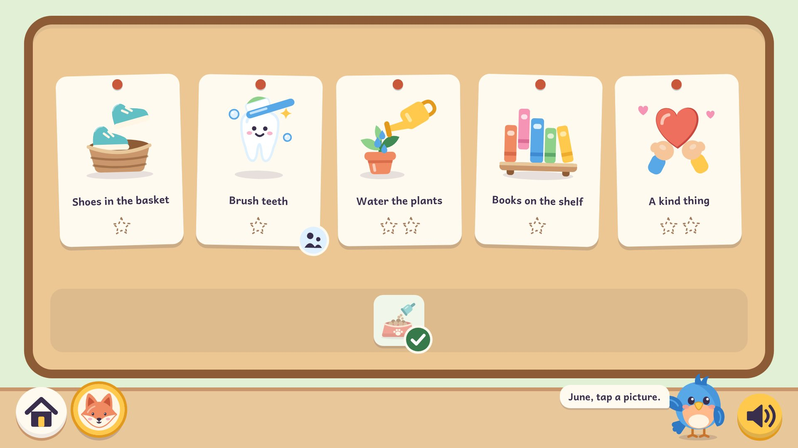 | 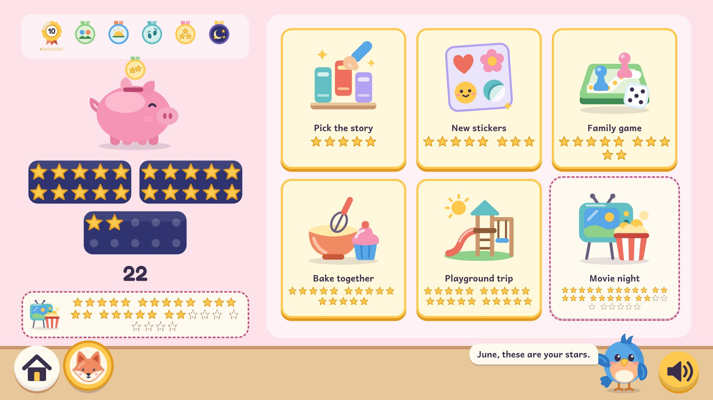 | 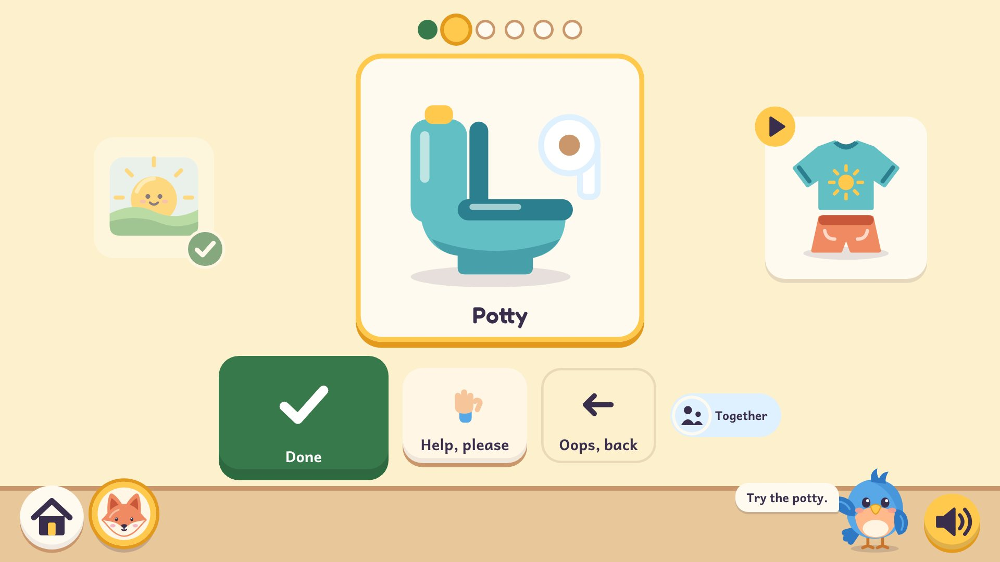 | 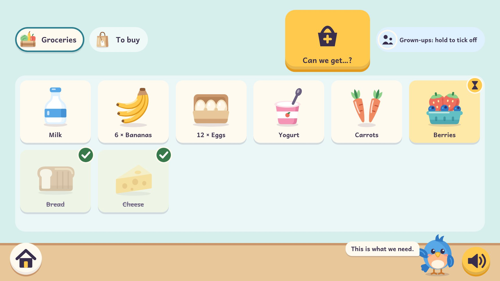 |

## The grown-ups' side

Words are allowed here. It borrows the wall's paper, ink and pictures so that a parent recognises a mission by
the same drawing their child does, but it is an ordinary, quick phone page: one column, a bar of five places at
the bottom, large touch targets, no decoration that slows a parent down.

| Today | Plan | History | Family |
| --- | --- | --- | --- |
| 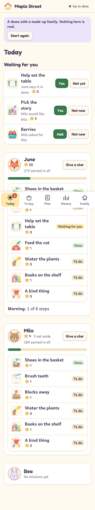 | 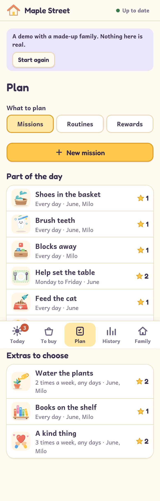 | 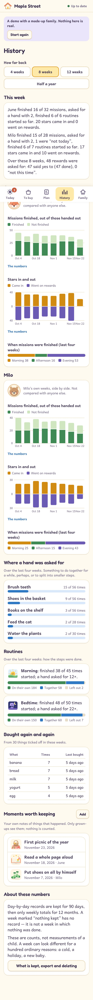 | 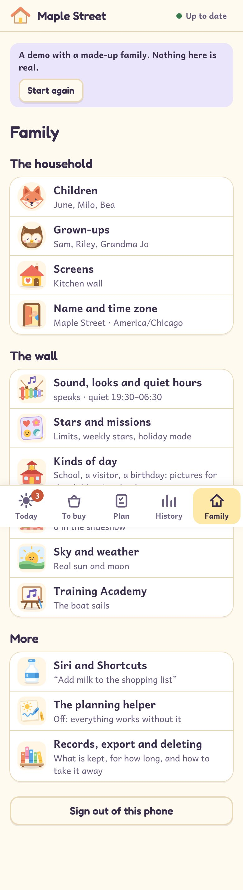 |

## What is still to be seen on the real display

Colour, glare, reach and smoothness on the actual panel are unknown until someone stands in front of it:
[`DEVICE-CHECKLIST.md`](DEVICE-CHECKLIST.md) sections B (reach, touch and sound) and H (how it feels).
