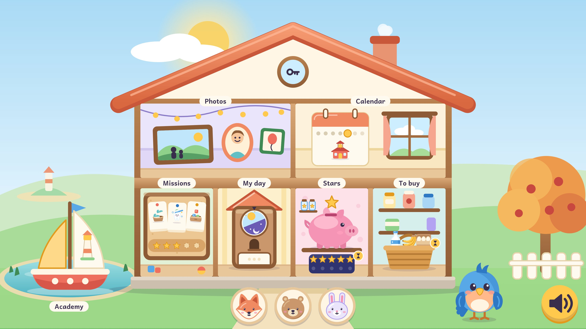
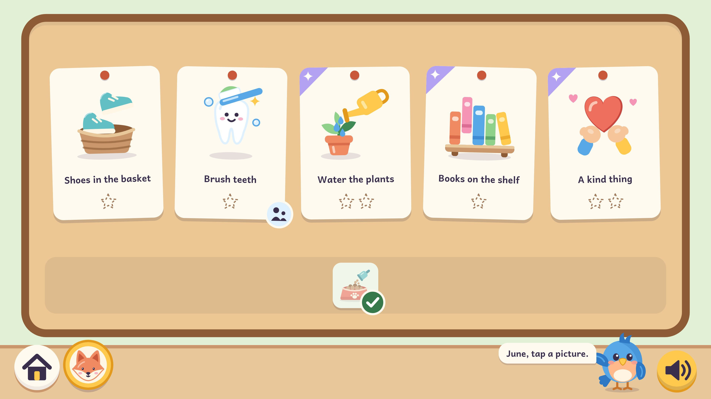
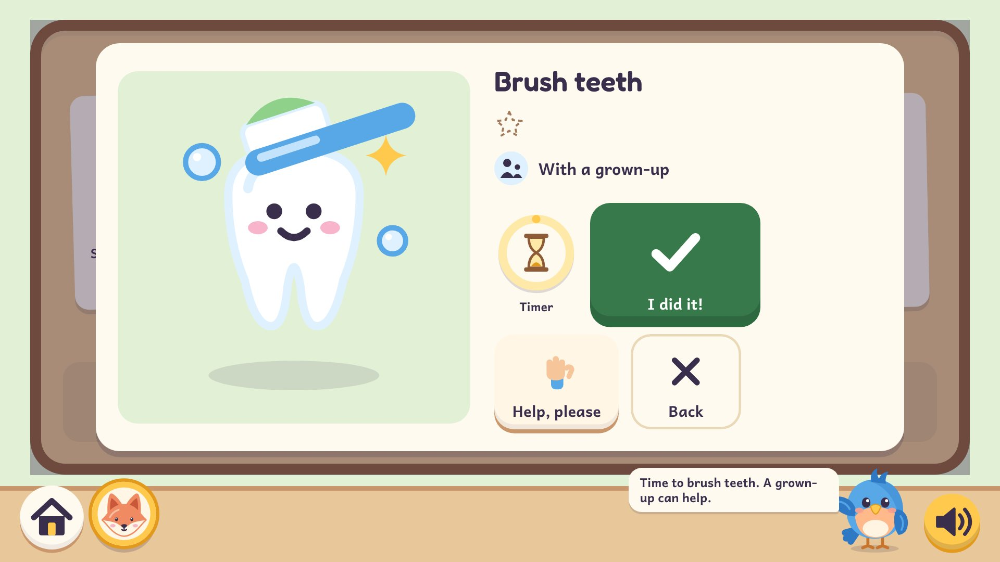
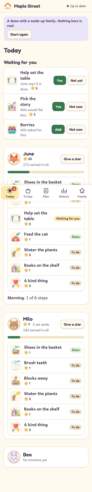
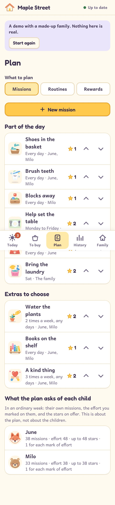
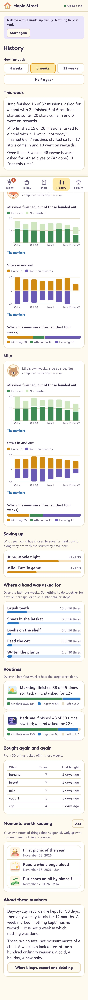

# Progress

Where HOMEBASE stands, in plain terms, with the evidence. Last brought up to date on 2026-11-26.

**In one paragraph.** HOMEBASE is built and works end to end with a made-up family: a child's wall of pictures,
the grown-ups' side on a phone, offline use, and everything needed to host it. It is covered by automated tests
on the built-in database, on real PostgreSQL and in a real browser. It has **not** yet been on the real
display, on an iPhone, on the internet, or in front of a real child, and it has never spoken to a real AI
provider. Those are the next steps, and each needs something only the family has.

## What the words mean

| Word | Meaning |
| --- | --- |
| **Verified** | Built, and an automated test or a browser run in this repository shows it working |
| **Simulated** | Works against a stand-in: a faked provider, the made-up family, or a headless browser instead of the display |
| **Hardware-pending** | Cannot be known until someone tries it on the real display or an iPhone |
| **Account-pending** | Needs the owner's account, key or permission |
| **Not built** | Not there. Listed, not hidden |
| **Unsupported** | Cannot be done as the brief imagined it, and why |

## At a glance

| Part | State | Evidence |
| --- | --- | --- |
| The wall: house, eight rooms, guide, 119 drawings, sound and speech | **Verified** in a browser at 1920×1080, 1280×720, an upright tablet and a phone. **Hardware-pending** for the display itself | `e2e/non-reader.spec.ts`, `e2e/layouts.spec.ts`; [`DEVICE-CHECKLIST.md`](DEVICE-CHECKLIST.md) |
| A child who cannot read can use it | **Verified** by a test that walks the whole journey by pictures and control names alone. **No real child has tried it** | `e2e/non-reader.spec.ts`; checklist section I |
| Missions (QUEST) | **Verified** | `tests/server/quest.test.ts` (19), `e2e/approval.spec.ts` |
| Stars and rewards (BANK) | **Verified** | `tests/server/bank.test.ts` (15), `e2e/rewards.spec.ts` |
| Routines | **Verified** | `tests/server/routines.test.ts` (10) |
| The shopping list (TO BUY) | **Verified**. The Siri Shortcut is **hardware-pending** (its server side is verified) | `tests/server/shopping.test.ts`, `shortcuts.test.ts`, `e2e/shopping.spec.ts` |
| The Training Academy | Opening it: **verified** up to the address it would go to. Bringing progress in: **verified** on the server. Coming home again from the Academy: **hardware-pending**. Live two-way sync: **not built** (needs changes to the Academy and the owner's say-so) | `tests/server/academy.test.ts`, `docs/integrations/ACADEMY.md` |
| The calendar | The display's own Calendar Mode is the calendar (**hardware-pending**). HOMEBASE shows parent-chosen kinds of day (**verified**). A calendar feed inside HOMEBASE: **not built** (the brief calls it optional) | `docs/INTEGRATIONS.md` |
| Photos (MEMORIES) | The display's screen saver first (**hardware-pending**). HOMEBASE's own slideshow and uploads: **verified** on the server; picking photos on a real phone is **hardware-pending**. Starting or setting up the display's Google Photos screen saver from HOMEBASE: **unsupported** (nothing documented allows it; it is set up on the display). Picking photos from Google Photos into HOMEBASE's own slideshow: **not built** (possible, with limits) | `tests/server/media.test.ts` |
| Looking back, export, correction, deletion (HISTORY) | **Verified** | `tests/server/history.test.ts` |
| Sign-in, invitations, pairing a wall, PIN | **Verified** | `tests/server/identity.test.ts` (20), `e2e/auth.spec.ts`, `e2e/pairing.spec.ts` |
| One household never sees another | **Verified**, including on real PostgreSQL with the database itself doing the refusing | `tests/server/isolation.test.ts`; `npm run test:pg` |
| Offline: taps kept, sent once, the house drawn with no signal | **Verified** | `e2e/offline.spec.ts`, `tests/server/store.test.ts` |
| The sky follows the real day and weather at home | Daylight: **verified** (worked out on the device). Weather: **simulated** in tests; one live request to each service was made during development from a made-up position | `tests/server/weather.test.ts`, `docs/integrations/WEATHER.md` |
| The planning helper (Anthropic or OpenAI) | **Simulated**: both providers are faked; no real request has ever been made. Four of the brief's eight jobs are built; four are **not built** | `tests/server/ai.test.ts` (29), `docs/integrations/AI.md` |
| Installable, offline shell, security headers | **Verified** against the production build on this machine | `npm run verify:deployment` |
| Hosting on Vercel with a real database | **Account-pending**. Written, configured and checked as far as possible without an account | [`DEPLOYMENT.md`](DEPLOYMENT.md) |
| Backup and restore | **Verified** on PostgreSQL with `pg_dump` and `psql` | `tests/server/backup.test.ts` |
| Smoothness at 4K | **Simulated** (headless, no graphics card). The wall drops its ambient movement by itself if the display cannot keep up | `npm run measure`; [`TEST_RESULTS.md`](TEST_RESULTS.md) |

Every requirement of the brief, one row each: [`TRACEABILITY.md`](TRACEABILITY.md).

## The evidence

- **Tests:** [`TEST_RESULTS.md`](TEST_RESULTS.md) — 456 unit and integration tests; 252 server tests again on
  PostgreSQL; 30 browser tests at four sizes; the deployment check; the wall measured.
- **Continuous integration:** `.github/workflows/ci.yml` runs all of it on every pull request. Its very first
  runs (pull request #3) found two real problems that only a brand-new database server shows — two databases
  racing to create the role they share, and a backup made by a newer `pg_dump` than the database it was put
  back into. Both were reproduced here, fixed, and proven on a fresh server. See the pull request for the
  current run.
- **Pictures:** [`review/screens/`](review/screens) — 61 screenshots of the wall (day, evening, night, rain,
  snow; 3840×2160, 1920×1080, 1280×720, an upright tablet, a phone) and of every page of the grown-ups' side.
  [`review/recordings/wall-journey.webm`](review/recordings/wall-journey.webm) is a half-minute film of a child's
  journey. All with the made-up family.
- **Audits:** the code was checked twice against its own documents and against all fifteen files of the brief
  by independent passes. What they found is in [`TEST_RESULTS.md`](TEST_RESULTS.md) ("What the tests found") and
  was fixed; what remains is in [`TRACEABILITY.md`](TRACEABILITY.md) ("What is not done").

| The wall, 4K | The mission board | A mission, with its gentle timer |
| --- | --- | --- |
|  |  |  |

| Today, on a phone | The plan | Looking back |
| --- | --- | --- |
|  |  |  |

## What needs the family

Nothing below can be done from here. Each is small, and written up so that it can be done without help.

| What | Who | How long | Where |
| --- | --- | --- | --- |
| Put it on the internet | Whoever has (or makes) a Vercel account and a free database | About half an hour | [`DEPLOYMENT.md`](DEPLOYMENT.md), then `npm run verify:deployment -- <address>` |
| An hour with the real display | A grown-up with a pencil | About an hour | [`DEVICE-CHECKLIST.md`](DEVICE-CHECKLIST.md) A–H |
| Ten minutes with a child | A willing child and a parent | Ten minutes | Checklist section I |
| An iPhone: home screen, Siri, photos | A parent | Ten minutes | [`PARENT-GUIDE.md`](PARENT-GUIDE.md), `docs/integrations/SHORTCUTS.md` |
| If the planning helper is wanted: one real request per provider | Whoever holds an API key | Five minutes, a few cents | `docs/integrations/AI.md` |

## Decisions that are the owner's

1. **Whether and where to deploy.** Nothing was created on any account. Supabase's free database suits a wall
   that is on all day; Neon's is fine for trying things ([`COSTS.md`](COSTS.md)).
2. **A licence for this public repository.** There is none yet ([`ASSETS.md`](ASSETS.md)).
3. **Whether to change the Training Academy** so that progress can flow without a file being carried across.
   HOMEBASE changes nothing in that repository; what would be needed is described in
   `docs/integrations/ACADEMY.md`.
4. **Whether to switch the planning helper on at all.** Everything works without it.

## Departures from the brief

Each is argued in [`DECISIONS.md`](DECISIONS.md); the ones that matter most:

- One web app and a small API instead of Next.js (§1); the same PostgreSQL in development, tests and production (§2).
- Screens keep in step by asking, not by a held-open connection (§4).
- Sign-in without e-mail: recovery codes and invitations instead (§5).
- The Academy is visited, not embedded — it forbids being framed (§12).
- The display's own calendar and screen saver come first; HOMEBASE does not imitate them (§13, §14).
- The planning helper calls providers over plain HTTPS rather than through their SDKs (§18).
- The cache on a device is not encrypted, with the reasons (§23).

## How it got here

| When | What |
| --- | --- |
| 25 Nov | The brief; discovery; three art directions drawn and compared; the storybook house chosen |
| 25–26 Nov | Foundation and server: identity, pairing, sync, missions, stars, routines, the shopping list (pull request #1) |
| 26 Nov | The wall: the house, eight rooms, the guide, 119 drawings, the sync client (pull request #2) |
| 26 Nov | The grown-ups' side; looking back, export, deletion; the real-sky weather; photos; Siri; the Academy import |
| 26 Nov | Installable and offline; security headers; hosting; CI |
| 26 Nov | Keepsakes, first-visit tour, the planning helper; the browser tests and what they found; hardening |
| 26 Nov | Audits against the documents and the brief; the gaps they found closed; documents and evidence (pull request #3) |

## Known rough edges

- Text on the grown-ups' side does not follow the phone's own text-size setting.
- Only Chromium has run the browser tests.
- A hosted demo with no database forgets what a visitor changed whenever its server is replaced (it lets the
  visitor straight back in, with the made-up family as it began).
- The wall's "what to wear" sign and the weather need the family's rough position, which only a parent can give.
- Everything in [`TRACEABILITY.md`](TRACEABILITY.md) under "What is not done".
